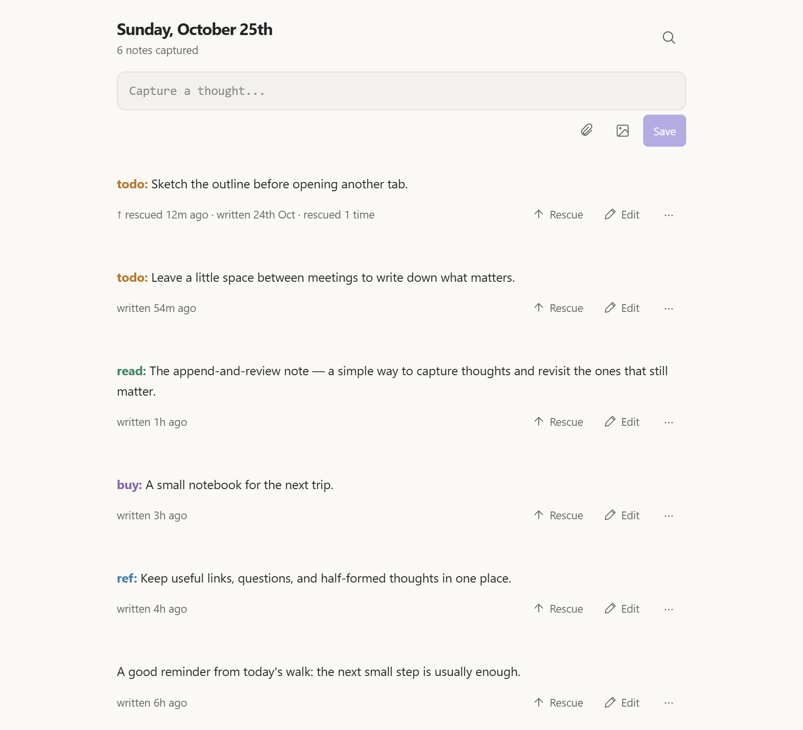
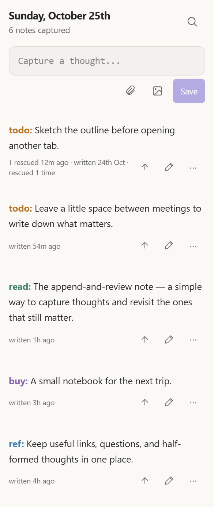

# Karpathy for Obsidian

One stream for quick notes, tasks, links, and the thoughts between tasks. Capture at the top, scroll back to review, and rescue anything worth bringing back to your attention.

Inspired by Andrej Karpathy's [append-and-review note](https://karpathy.bearblog.dev/the-append-and-review-note/). This is an independent community plugin, not affiliated with Andrej Karpathy.





*Demo previews rendered from the plugin UI with sample notes. The narrow preview is not a physical-device screenshot.*

## Use

- Open **Karpathy: Open stream** from the command palette.
- Write Markdown. Save with **Ctrl/Cmd+Enter**, three consecutive plain Enter presses at the end, or **Save**. Existing blank lines do not count. Typing, cursor movement, paste, Shift+Enter, or leaving the editor resets the gesture. Two Enter presses keep a paragraph break.
- Headings, text fonts, colors, and reading width follow your selected Obsidian theme. Compact panes keep the entry actions visible as icons with generous tap targets.
- Enter continues bullets, numbered lists, and checklists. For a normal list: first Enter continues the bullet, second removes the empty bullet, third adds spacing, fourth saves. Nested lists exit one level at a time; those intermediate steps do not advance the save gesture. **Shift+Enter** inserts a plain newline.
- Paste images and files, or use the file and photo buttons beside Save. Enter at the end of an image/embed line moves below it without counting toward save; three more consecutive Enters save.
- Paste a single HTTP/HTTPS URL to turn it into `[page title](url)` in capture or Edit. Paste over selected text to use that text as the label. A single rich clipboard link supplies its label immediately without a request, even with network fetching disabled. When no usable clipboard label is available, title lookup contacts the linked page directly; it does not send note content. Typing stays available during lookup. If the page is unavailable, has no title, takes more than five seconds, or you save first, the original URL is kept. Code and existing link destinations keep normal paste behavior. Undo reverses a title conversion.
- Type `[[` in capture or Edit to suggest existing files and aliases from anywhere in the vault. Filter by typing, select with arrows and Enter/Tab or tap a result, and press Escape to dismiss. Folder paths distinguish duplicate names. Heading and block suggestions are not included yet.
- Search from the header. Use **Rescue** to move an entry to the top; **Edit** changes it in place.
- Choose **Delete entry** from an entry's **…** menu and confirm to remove it. Other entries and attachments are kept.
- Start with `todo:`, `read:`, `buy:`, or `ref:` for theme-colored prefixes. New prefixes join the settings list when first saved.
- Enable **Hide sidebars** in settings to hide both sidebars and the left ribbon. Restore them with **Karpathy: Toggle hidden sidebars** in the command palette or turn off the setting. This applies throughout the vault and is removed when the plugin is disabled.

Each entry is a separate Markdown file in its creation month:

```text
Karpathy/2026/2026-10/2026-10-25-091530123-a1b2c3d4e5f6.md
Karpathy/2026/2026-10/attachments/
```

The base folder is configurable. Leave **Base notes folder** blank (or enter `/`) and click **Apply** to use the vault root: `2026/2026-10/2026-10-25-091530123-a1b2c3d4e5f6.md`, with attachments in `2026/2026-10/attachments/`. Changing the folder does not move existing files or import arbitrary Markdown notes into the stream.

Entries use standard YAML properties (`karpathy`, `id`, `created`, `rescued`, `rescues`) followed by ordinary Markdown. Rescue updates the same file without moving it, preserving links and its creation date. Delete moves only that entry file to trash; attachments are retained. Attachment filenames include a random suffix to avoid cross-device collisions.

A rebuildable IndexedDB index stays on each device, outside the synced vault. It stores ordering and search data; entry files remain authoritative. Paging and memory caches stay bounded. Use **Refresh stream and cache** to rebuild the index. Conflicting copies with the same entry ID are shown separately and marked for review. Editing the same entry on two devices still depends on your sync tool's conflict policy.

**Version 2 uses a new storage format.** There is no automatic conversion: existing version 1 daily files remain untouched and are not displayed. Start with a clean capture folder, keep a backup of any old notes you need, and update every device before using version 2. Do not downgrade after creating version 2 entries. See [storage details](docs/storage.md).

## Install with BRAT

1. Install and enable [BRAT](https://github.com/TfTHacker/obsidian42-brat) in Obsidian.
2. Run **BRAT: Add a beta plugin for testing** and enter `da5is/obsidian-karpathy` (or this repository's URL).
3. Select the latest release, then enable **Karpathy** in Community plugins.

For manual installation, download `main.js`, `manifest.json`, and `styles.css` from [Releases](https://github.com/da5is/obsidian-karpathy/releases/latest) into your vault's `.obsidian/plugins/karpathy/` folder.

Designed for desktop, iPhone/iPad, and Android. Desktop capture and rescue have been checked in Obsidian; physical mobile testing is still needed. Clipboard support depends on the OS. Live formatting covers common Markdown; advanced tables and callouts render after saving.

## Reliability and diagnostics

Use **Karpathy: Review storage health** to find skipped or renamed entries, duplicate identities, and potentially unused attachments. Restoring an entry path requires confirmation and never overwrites an existing file.

One pane owns each capture/edit draft. Large drafts use source editing; attachments are limited to 50 MiB each. **Fetch pasted URL titles** can be disabled in settings. See [compatibility, performance checks, and limits](docs/compatibility.md).

## Using an LLM with your vault

Give the LLM the standalone [vault instructions](docs/VAULT_LLM_GUIDE.md). You can copy that file into your vault as `KARPATHY_VAULT_GUIDE.md` and explicitly ask the LLM to read it before working. It describes paths, YAML, attachments, stream order, safe writes, and sync conflicts. It does not authorize changes to your notes on its own.

## Development

```sh
npm ci
npm test
npm run build
```

See [portable setup and native test-vault instructions](docs/development.md) and the [new-chat handoff](docs/handoff.md).

The production bundle is `main.js`. Settings, drafts, vault notes, and dependencies are not part of this repository.

MIT licensed.
