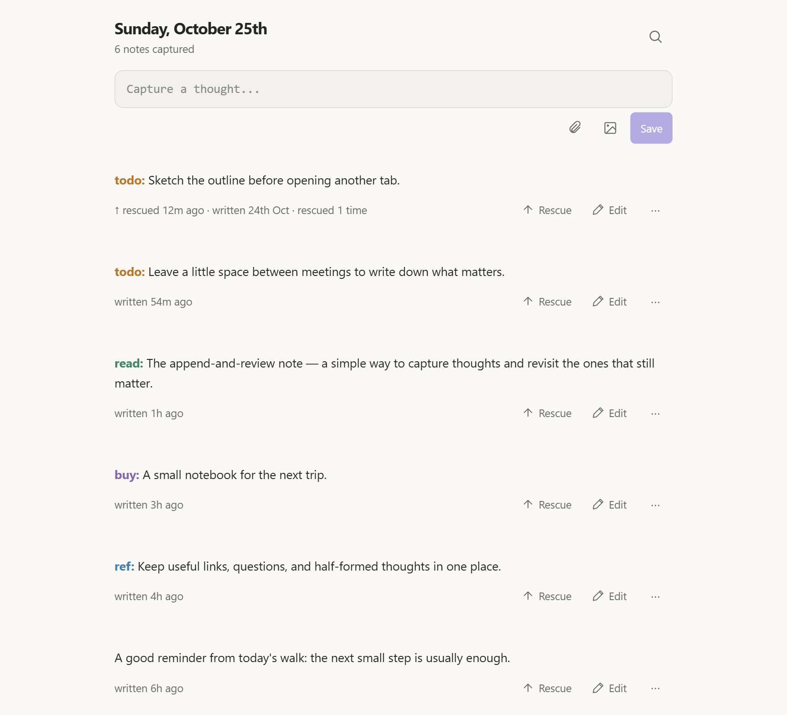

# Karpathy for Obsidian

One stream for quick notes, tasks, and links. Capture at the top, scroll back to review, and **Rescue** anything worth bringing back to the top.

Inspired by Andrej Karpathy's [append-and-review note](https://karpathy.bearblog.dev/the-append-and-review-note/). Independent community plugin; not affiliated with Andrej Karpathy.



## Use

- Run **Karpathy: Open stream** from the command palette.
- Type Markdown and save with **Ctrl/Cmd+Enter**, three Enters at the end, or **Save**.
- Paste images, files, and links; type `[[` or `#` for suggestions.
- Start a note with `todo:`, `read:`, `buy:`, or `ref:` for a colored prefix.
- Search from the header, or click a prefix or tag to filter.
- Each entry has **Rescue**, **Edit**, and (in its **…** menu) **Delete**, with Undo.

Each entry is its own Markdown file, e.g. `Karpathy/2026/2026-10/2026-10-25-091530123-a1b2c3d4e5f6.md`.

> **Version 2 uses a new storage format** and does not show or convert version 1 daily files. Update every device before using it, and don't downgrade.

More detail: [usage](docs/usage.md) · [storage](docs/storage.md) · [compatibility and limits](docs/compatibility.md) · [guide for LLMs working in your vault](docs/VAULT_LLM_GUIDE.md)

## Install

With [BRAT](https://github.com/TfTHacker/obsidian42-brat): run **BRAT: Add a beta plugin for testing**, enter `da5is/obsidian-karpathy`, then enable **Karpathy**.

Manually: copy `main.js`, `manifest.json`, and `styles.css` from the [latest release](https://github.com/da5is/obsidian-karpathy/releases/latest) into `.obsidian/plugins/karpathy/`.

Works on desktop and mobile; physical mobile testing is still pending.

## Development

```sh
npm ci
npm test
npm run build
```

See [development](docs/development.md) and [handoff](docs/handoff.md).

MIT licensed.
